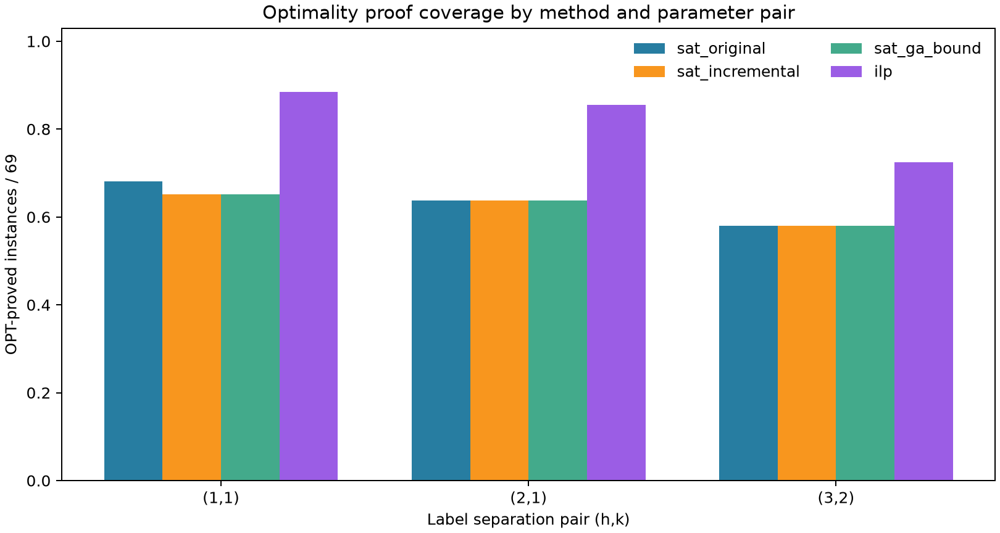
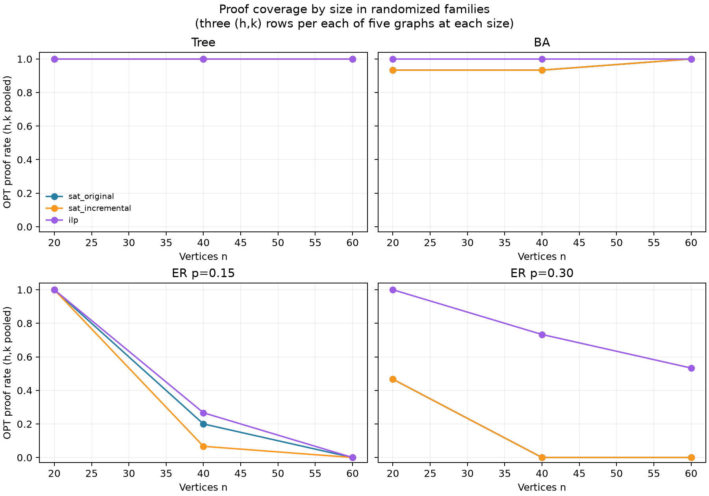
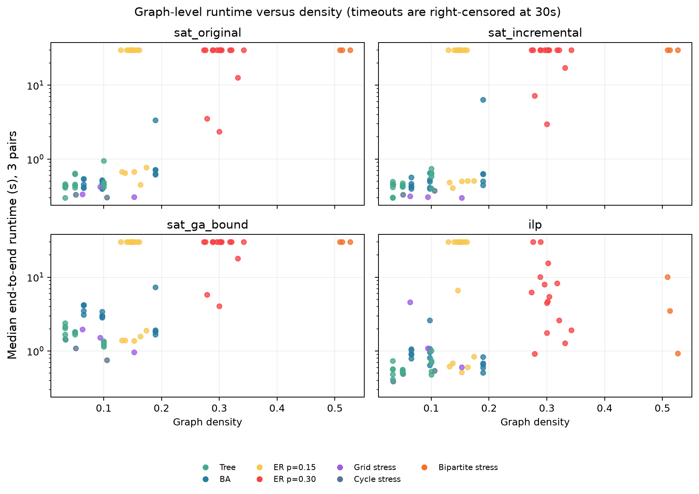
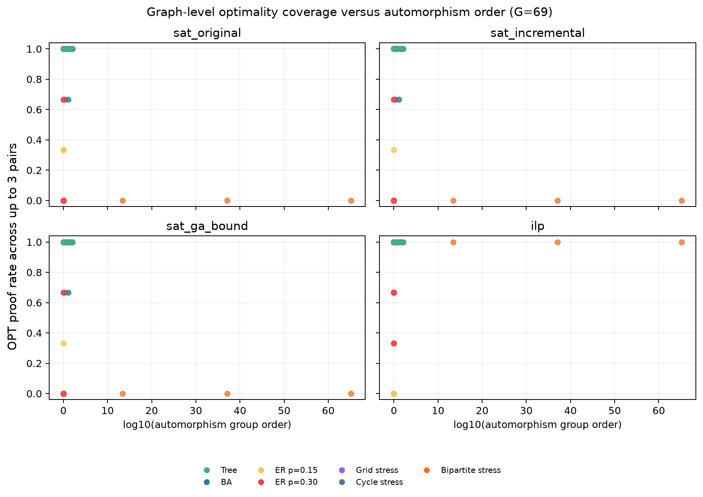
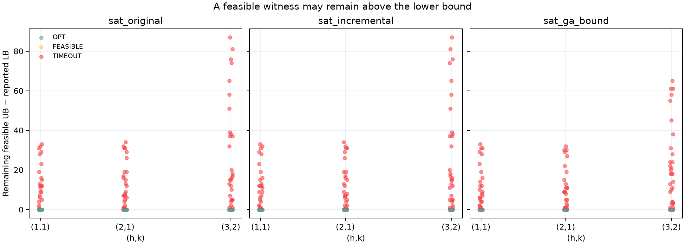

# Graph Structural Analysis — Phase 2: SAT vs ILP Difficulty

## 1. Data audit

- **Audit: PASS.** Manifest SHA-256 `011c0750f1bc8617f3af583a4625ec3a74cf7605c177bf5b5570d9c31cb2f973` matches the required digest.
- 69 unique manifest graphs, 207 graph–parameter instances, 1,242 benchmark rows; parameter pairs `[(1, 1), (2, 1), (3, 2)]`; methods `ga, ilp, random_order, sat_ga_bound, sat_incremental, sat_original`.
- Original benchmark and Phase 1 joined file match row-for-row on all 34 original columns and on all `(Instance,h,k,Method)` keys. Duplicate keys: 0; missing/extra keys: 0.
- Automorphism records map exactly to all manifest graph IDs (n=69); the per-graph manifest edge hash copied into Phase 1 also matches.
- The independent unit is the graph (G=69). Comparisons by `(h,k)` have at most 69 graph clusters; combined summaries average repeated parameter rows within a graph. No solver, GA, or benchmark was run.

## 2. Paired SAT–ILP optimality outcomes

Classification uses `Status == OPT` **and** `Optimality_Proven == True`; the last-query `Solver_Outcome` is retained as a separate diagnostic. ILP OPT rows require the recorded Gurobi `OPTIMAL` result. A feasible witness with a positive `UB−LB` remains FEASIBLE/unproved.

### Overall, each SAT method paired with ILP (207 instances per row)

| SAT_Method | n_pairs | both_OPT | SAT_only_OPT | ILP_only_OPT | neither_OPT | SAT_OPT_elementary_bound | SAT_OPT_sat_search | ILP_OPT_Gurobi | SAT_timeouts | ILP_timeouts | SAT_feasible_unproved | ILP_feasible_unproved | SAT_timeout_with_verified_witness | ILP_timeout_with_verified_witness |
|---|---|---|---|---|---|---|---|---|---|---|---|---|---|---|
| sat_original | 207 | 130 | 1 | 40 | 36 | 31 | 100 | 170 | 76 | 37 | 0 | 0 | 76 | 37 |
| sat_incremental | 207 | 129 | 0 | 41 | 37 | 31 | 98 | 170 | 78 | 37 | 0 | 0 | 78 | 37 |
| sat_ga_bound | 207 | 129 | 0 | 41 | 37 | 90 | 39 | 170 | 78 | 37 | 0 | 0 | 78 | 37 |

SAT source counts refer to SAT OPT results only. Exact SAT/ILP methods have no `Status=FEASIBLE` rows in this benchmark; their timeouts often do carry an independently verified feasible witness and a positive remaining UB−LB gap, counted in the final table columns. SAT and ILP timeout rows are right-censored at the 30-second per-method cap; the cap is not an exact solve time.

### Paired outcomes by (h,k), n=69 graph clusters per parameter pair

| h | k | SAT_Method | n_paired_instances | both_OPT | SAT_only_OPT | ILP_only_OPT | neither_OPT | SAT_timeout | ILP_timeout |
|---|---|---|---|---|---|---|---|---|---|
| 1 | 1 | sat_ga_bound | 69 | 45 | 0 | 16 | 8 | 24 | 8 |
| 1 | 1 | sat_incremental | 69 | 45 | 0 | 16 | 8 | 24 | 8 |
| 1 | 1 | sat_original | 69 | 46 | 1 | 15 | 7 | 22 | 8 |
| 2 | 1 | sat_ga_bound | 69 | 44 | 0 | 15 | 10 | 25 | 10 |
| 2 | 1 | sat_incremental | 69 | 44 | 0 | 15 | 10 | 25 | 10 |
| 2 | 1 | sat_original | 69 | 44 | 0 | 15 | 10 | 25 | 10 |
| 3 | 2 | sat_ga_bound | 69 | 40 | 0 | 10 | 19 | 29 | 19 |
| 3 | 2 | sat_incremental | 69 | 40 | 0 | 10 | 19 | 29 | 19 |
| 3 | 2 | sat_original | 69 | 40 | 0 | 10 | 19 | 29 | 19 |

Figure 1 shows marginal OPT-proof coverage by method and parameter pair; the paired counts above remain the primary comparison.

### Paired outcomes by graph family, all parameter pairs pooled

| Family | SAT_Method | n_paired_instances | both_OPT | SAT_only_OPT | ILP_only_OPT | neither_OPT | SAT_timeout | ILP_timeout |
|---|---|---|---|---|---|---|---|---|
| BA | sat_ga_bound | 45 | 43 | 0 | 2 | 0 | 2 | 0 |
| BA | sat_incremental | 45 | 43 | 0 | 2 | 0 | 2 | 0 |
| BA | sat_original | 45 | 43 | 0 | 2 | 0 | 2 | 0 |
| Bipartite stress | sat_ga_bound | 9 | 0 | 0 | 9 | 0 | 9 | 0 |
| Bipartite stress | sat_incremental | 9 | 0 | 0 | 9 | 0 | 9 | 0 |
| Bipartite stress | sat_original | 9 | 0 | 0 | 9 | 0 | 9 | 0 |
| Cycle stress | sat_ga_bound | 9 | 9 | 0 | 0 | 0 | 0 | 0 |
| Cycle stress | sat_incremental | 9 | 9 | 0 | 0 | 0 | 0 | 0 |
| Cycle stress | sat_original | 9 | 9 | 0 | 0 | 0 | 0 | 0 |
| ER p=0.15 | sat_ga_bound | 45 | 16 | 0 | 3 | 26 | 29 | 26 |
| ER p=0.15 | sat_incremental | 45 | 16 | 0 | 3 | 26 | 29 | 26 |
| ER p=0.15 | sat_original | 45 | 17 | 1 | 2 | 25 | 27 | 26 |
| ER p=0.30 | sat_ga_bound | 45 | 7 | 0 | 27 | 11 | 38 | 11 |
| ER p=0.30 | sat_incremental | 45 | 7 | 0 | 27 | 11 | 38 | 11 |
| ER p=0.30 | sat_original | 45 | 7 | 0 | 27 | 11 | 38 | 11 |
| Grid stress | sat_ga_bound | 9 | 9 | 0 | 0 | 0 | 0 | 0 |
| Grid stress | sat_incremental | 9 | 9 | 0 | 0 | 0 | 0 | 0 |
| Grid stress | sat_original | 9 | 9 | 0 | 0 | 0 | 0 | 0 |
| Tree | sat_ga_bound | 45 | 45 | 0 | 0 | 0 | 0 | 0 |
| Tree | sat_incremental | 45 | 45 | 0 | 0 | 0 | 0 | 0 |
| Tree | sat_original | 45 | 45 | 0 | 0 | 0 | 0 | 0 |

### By graph family and size, with three parameter rows per graph

| Family | n | SAT_Method | G | pairs | both | SAT_only | ILP_only | neither |
|---|---|---|---|---|---|---|---|---|
| BA | 20 | sat_ga_bound | 5 | 15 | 14 | 0 | 1 | 0 |
| BA | 20 | sat_incremental | 5 | 15 | 14 | 0 | 1 | 0 |
| BA | 20 | sat_original | 5 | 15 | 14 | 0 | 1 | 0 |
| BA | 40 | sat_ga_bound | 5 | 15 | 14 | 0 | 1 | 0 |
| BA | 40 | sat_incremental | 5 | 15 | 14 | 0 | 1 | 0 |
| BA | 40 | sat_original | 5 | 15 | 14 | 0 | 1 | 0 |
| BA | 60 | sat_ga_bound | 5 | 15 | 15 | 0 | 0 | 0 |
| BA | 60 | sat_incremental | 5 | 15 | 15 | 0 | 0 | 0 |
| BA | 60 | sat_original | 5 | 15 | 15 | 0 | 0 | 0 |
| Bipartite stress | 20 | sat_ga_bound | 1 | 3 | 0 | 0 | 3 | 0 |
| Bipartite stress | 20 | sat_incremental | 1 | 3 | 0 | 0 | 3 | 0 |
| Bipartite stress | 20 | sat_original | 1 | 3 | 0 | 0 | 3 | 0 |
| Bipartite stress | 40 | sat_ga_bound | 1 | 3 | 0 | 0 | 3 | 0 |
| Bipartite stress | 40 | sat_incremental | 1 | 3 | 0 | 0 | 3 | 0 |
| Bipartite stress | 40 | sat_original | 1 | 3 | 0 | 0 | 3 | 0 |
| Bipartite stress | 60 | sat_ga_bound | 1 | 3 | 0 | 0 | 3 | 0 |
| Bipartite stress | 60 | sat_incremental | 1 | 3 | 0 | 0 | 3 | 0 |
| Bipartite stress | 60 | sat_original | 1 | 3 | 0 | 0 | 3 | 0 |
| Cycle stress | 20 | sat_ga_bound | 1 | 3 | 3 | 0 | 0 | 0 |
| Cycle stress | 20 | sat_incremental | 1 | 3 | 3 | 0 | 0 | 0 |
| Cycle stress | 20 | sat_original | 1 | 3 | 3 | 0 | 0 | 0 |
| Cycle stress | 40 | sat_ga_bound | 1 | 3 | 3 | 0 | 0 | 0 |
| Cycle stress | 40 | sat_incremental | 1 | 3 | 3 | 0 | 0 | 0 |
| Cycle stress | 40 | sat_original | 1 | 3 | 3 | 0 | 0 | 0 |
| Cycle stress | 60 | sat_ga_bound | 1 | 3 | 3 | 0 | 0 | 0 |
| Cycle stress | 60 | sat_incremental | 1 | 3 | 3 | 0 | 0 | 0 |
| Cycle stress | 60 | sat_original | 1 | 3 | 3 | 0 | 0 | 0 |
| ER p=0.15 | 20 | sat_ga_bound | 5 | 15 | 15 | 0 | 0 | 0 |
| ER p=0.15 | 20 | sat_incremental | 5 | 15 | 15 | 0 | 0 | 0 |
| ER p=0.15 | 20 | sat_original | 5 | 15 | 15 | 0 | 0 | 0 |
| ER p=0.15 | 40 | sat_ga_bound | 5 | 15 | 1 | 0 | 3 | 11 |
| ER p=0.15 | 40 | sat_incremental | 5 | 15 | 1 | 0 | 3 | 11 |
| ER p=0.15 | 40 | sat_original | 5 | 15 | 2 | 1 | 2 | 10 |
| ER p=0.15 | 60 | sat_ga_bound | 5 | 15 | 0 | 0 | 0 | 15 |
| ER p=0.15 | 60 | sat_incremental | 5 | 15 | 0 | 0 | 0 | 15 |
| ER p=0.15 | 60 | sat_original | 5 | 15 | 0 | 0 | 0 | 15 |
| ER p=0.30 | 20 | sat_ga_bound | 5 | 15 | 7 | 0 | 8 | 0 |
| ER p=0.30 | 20 | sat_incremental | 5 | 15 | 7 | 0 | 8 | 0 |
| ER p=0.30 | 20 | sat_original | 5 | 15 | 7 | 0 | 8 | 0 |
| ER p=0.30 | 40 | sat_ga_bound | 5 | 15 | 0 | 0 | 11 | 4 |
| ER p=0.30 | 40 | sat_incremental | 5 | 15 | 0 | 0 | 11 | 4 |
| ER p=0.30 | 40 | sat_original | 5 | 15 | 0 | 0 | 11 | 4 |
| ER p=0.30 | 60 | sat_ga_bound | 5 | 15 | 0 | 0 | 8 | 7 |
| ER p=0.30 | 60 | sat_incremental | 5 | 15 | 0 | 0 | 8 | 7 |
| ER p=0.30 | 60 | sat_original | 5 | 15 | 0 | 0 | 8 | 7 |
| Grid stress | 21 | sat_ga_bound | 1 | 3 | 3 | 0 | 0 | 0 |
| Grid stress | 21 | sat_incremental | 1 | 3 | 3 | 0 | 0 | 0 |
| Grid stress | 21 | sat_original | 1 | 3 | 3 | 0 | 0 | 0 |
| Grid stress | 36 | sat_ga_bound | 1 | 3 | 3 | 0 | 0 | 0 |
| Grid stress | 36 | sat_incremental | 1 | 3 | 3 | 0 | 0 | 0 |
| Grid stress | 36 | sat_original | 1 | 3 | 3 | 0 | 0 | 0 |
| Grid stress | 55 | sat_ga_bound | 1 | 3 | 3 | 0 | 0 | 0 |
| Grid stress | 55 | sat_incremental | 1 | 3 | 3 | 0 | 0 | 0 |
| Grid stress | 55 | sat_original | 1 | 3 | 3 | 0 | 0 | 0 |
| Tree | 20 | sat_ga_bound | 5 | 15 | 15 | 0 | 0 | 0 |
| Tree | 20 | sat_incremental | 5 | 15 | 15 | 0 | 0 | 0 |
| Tree | 20 | sat_original | 5 | 15 | 15 | 0 | 0 | 0 |
| Tree | 40 | sat_ga_bound | 5 | 15 | 15 | 0 | 0 | 0 |
| Tree | 40 | sat_incremental | 5 | 15 | 15 | 0 | 0 | 0 |
| Tree | 40 | sat_original | 5 | 15 | 15 | 0 | 0 | 0 |
| Tree | 60 | sat_ga_bound | 5 | 15 | 15 | 0 | 0 | 0 |
| Tree | 60 | sat_incremental | 5 | 15 | 15 | 0 | 0 | 0 |
| Tree | 60 | sat_original | 5 | 15 | 15 | 0 | 0 | 0 |

Rows with a discordant proof result (one method proves OPT and the other does not): **123**. See `sat_ilp_disagreement_cases.csv` for the exact graph, `(h,k)`, statuses, proof sources, bounds, and timing. ILP OPT while paired SAT does not: 122 rows; all 122 are SAT TIMEOUT / ILP OPT, representing 41 distinct graph–parameter instances repeated across SAT methods. The reverse direction has 1 row(s), including 1 SAT OPT / ILP TIMEOUT case(s). The file retains the method-level repeats and separate statuses.

## 3. Structural factors

`feature_outcome_analysis.csv` reports graph-cluster descriptive rates and exploratory Spearman rank correlations without p-values. All HK-aggregated coefficients use one row per graph and a graph's mean proof outcome across its three pairs. Parameter-stratified coefficients use one graph result per pair. `n_nonmissing` is reported for every feature and scope. The raw group order is preserved in Phase 1; correlations use `log10(order)`.

### Overall graph-level exploratory rank correlations (G=69; outcomes averaged across 3 pairs)

| SAT_Method | Feature | independent_graphs | graphs_with_feature | graphs_missing_feature | mean_graph_SAT_OPT_rate | mean_graph_ILP_OPT_rate | SAT_only_OPT_pairs | ILP_only_OPT_pairs | Spearman_feature_vs_SAT_nonproof | Spearman_feature_vs_ILP_nonproof |
|---|---|---|---|---|---|---|---|---|---|---|
| sat_original | n | 69 | 69 | 0 | 0.6328502415458938 | 0.821256038647343 | 1 | 40 | 0.2534548375072993 | 0.42084631641212644 |
| sat_original | m | 69 | 69 | 0 | 0.6328502415458938 | 0.821256038647343 | 1 | 40 | 0.7611931178614348 | 0.6717006827907511 |
| sat_original | density | 69 | 69 | 0 | 0.6328502415458938 | 0.821256038647343 | 1 | 40 | 0.7022360577784489 | 0.3405809243135915 |
| sat_original | diameter | 69 | 64 | 5 | 0.6328502415458938 | 0.821256038647343 | 1 | 40 | -0.7860467917998024 | -0.4416560414232643 |
| sat_incremental | n | 69 | 69 | 0 | 0.6231884057971014 | 0.821256038647343 | 0 | 41 | 0.24707569024468268 | 0.42084631641212644 |
| sat_incremental | m | 69 | 69 | 0 | 0.6231884057971014 | 0.821256038647343 | 0 | 41 | 0.7541523566507841 | 0.6717006827907511 |
| sat_incremental | density | 69 | 69 | 0 | 0.6231884057971014 | 0.821256038647343 | 0 | 41 | 0.6882325834121901 | 0.3405809243135915 |
| sat_incremental | diameter | 69 | 64 | 5 | 0.6231884057971014 | 0.821256038647343 | 0 | 41 | -0.7828985073469497 | -0.4416560414232643 |
| sat_ga_bound | n | 69 | 69 | 0 | 0.6231884057971014 | 0.821256038647343 | 0 | 41 | 0.24707569024468268 | 0.42084631641212644 |
| sat_ga_bound | m | 69 | 69 | 0 | 0.6231884057971014 | 0.821256038647343 | 0 | 41 | 0.7541523566507841 | 0.6717006827907511 |
| sat_ga_bound | density | 69 | 69 | 0 | 0.6231884057971014 | 0.821256038647343 | 0 | 41 | 0.6882325834121901 | 0.3405809243135915 |
| sat_ga_bound | diameter | 69 | 64 | 5 | 0.6231884057971014 | 0.821256038647343 | 0 | 41 | -0.7828985073469497 | -0.4416560414232643 |

### Automorphism-focused correlations (G=69, one graph per point)

| SAT_Method | Feature | independent_graphs | graphs_with_feature | graphs_missing_feature | mean_graph_SAT_OPT_rate | mean_graph_ILP_OPT_rate | Spearman_feature_vs_SAT_nonproof | Spearman_feature_vs_ILP_nonproof | Spearman_feature_vs_ILP_minus_SAT_proof_rate |
|---|---|---|---|---|---|---|---|---|---|
| sat_original | log10_automorphism_order | 69 | 69 | 0 | 0.6328502415458938 | 0.821256038647343 | -0.4631161241796475 | -0.569973433669449 | -0.18985135919202237 |
| sat_original | vertex_orbit_count | 69 | 69 | 0 | 0.6328502415458938 | 0.821256038647343 | 0.3559501633582762 | 0.6080372633851319 | 0.002830362526750608 |
| sat_original | largest_orbit_fraction | 69 | 69 | 0 | 0.6328502415458938 | 0.821256038647343 | -0.5262890386574864 | -0.7500295742895768 | -0.12640048542401278 |
| sat_incremental | log10_automorphism_order | 69 | 69 | 0 | 0.6231884057971014 | 0.821256038647343 | -0.472785407624198 | -0.569973433669449 | -0.21962776818925142 |
| sat_incremental | vertex_orbit_count | 69 | 69 | 0 | 0.6231884057971014 | 0.821256038647343 | 0.35571499470501555 | 0.6080372633851319 | 0.013605264075487981 |
| sat_incremental | largest_orbit_fraction | 69 | 69 | 0 | 0.6231884057971014 | 0.821256038647343 | -0.5329507979388296 | -0.7500295742895768 | -0.15476789070185468 |
| sat_ga_bound | log10_automorphism_order | 69 | 69 | 0 | 0.6231884057971014 | 0.821256038647343 | -0.472785407624198 | -0.569973433669449 | -0.21962776818925142 |
| sat_ga_bound | vertex_orbit_count | 69 | 69 | 0 | 0.6231884057971014 | 0.821256038647343 | 0.35571499470501555 | 0.6080372633851319 | 0.013605264075487981 |
| sat_ga_bound | largest_orbit_fraction | 69 | 69 | 0 | 0.6231884057971014 | 0.821256038647343 | -0.5329507979388296 | -0.7500295742895768 | -0.15476789070185468 |

### Within randomized families, pooled across (h,k), G=15 graphs per family

| Family | Feature | G | missing | rho_vs_SAT_nonproof | rho_vs_ILP_nonproof | rho_vs_ILP_minus_SAT_proof |
|---|---|---|---|---|---|---|
| Tree | n | 15 | 0 |  |  |  |
| Tree | density | 15 | 0 |  |  |  |
| Tree | diameter | 15 | 0 |  |  |  |
| Tree | log10_automorphism_order | 15 | 0 |  |  |  |
| BA | n | 15 | 0 | -0.24019223070763074 |  | -0.24019223070763074 |
| BA | density | 15 | 0 | 0.24019223070763074 |  | 0.24019223070763074 |
| BA | diameter | 15 | 0 | -0.08006407690254357 |  | -0.08006407690254357 |
| BA | log10_automorphism_order | 15 | 0 | 0.21320869288689465 |  | 0.21320869288689465 |
| ER p=0.15 | n | 15 | 0 | 0.9185586535436917 | 0.9157015435010396 | 0.0 |
| ER p=0.15 | density | 15 | 0 | 0.03857583749052297 | -0.18458808070565674 | 0.3759603088707022 |
| ER p=0.15 | diameter | 15 | 5 | -0.8068715304598785 | -0.8068715304598785 | 0.0 |
| ER p=0.15 | log10_automorphism_order | 15 | 0 | -0.48903799777246976 | -0.48751688056423936 | -0.0648458070716574 |
| ER p=0.30 | n | 15 | 0 | 0.6089984572058625 | 0.8579069142420251 | -0.12024072240843035 |
| ER p=0.30 | density | 15 | 0 | -0.014079118426994114 | -0.374403541265305 | 0.37148005060114075 |
| ER p=0.30 | diameter | 15 | 0 | -0.4872793144576046 | -0.30449922860293127 | -0.22958842168866875 |
| ER p=0.30 | log10_automorphism_order | 15 | 0 |  |  |  |

Figures 2–4 visualize size-stratified proof coverage, graph-level runtime versus density, and automorphism order versus proof coverage. Randomized families contain 15 graphs overall and five graphs at each size; three `(h,k)` rows per graph are repeated observations, not 15 independent samples per size. Cycle, Grid, and Bipartite stress families each contain only three graphs and are treated as case studies.

## 4. Automorphism structure

Phase 1 computed exact automorphism group orders and orbits for 69/69 graphs. `log10(order)`, orbit count, and largest-orbit fraction are associated descriptively with graph-level proof rates in the table/plot above. The stress examples have structurally extreme groups: cycles have order `2n` and one orbit; `K_{r,r}` has order `2(r!)^2` and one orbit; rectangular grids have order 4. But these three families have only three graphs each, and family/edge density/diameter are strongly entangled. Moreover, Phase 1 established that SAT did not add generic automorphism constraints; only canonical cycles receive a root fix and cycle ordering constraint. Thus group order cannot be interpreted as an exploited SAT feature, and its association cannot establish a hardness mechanism.

## 5. SAT internal behavior

`sat_internal_behavior.csv` contains one row per SAT graph-parameter-method observation (621 rows), retaining status, last-query outcome, termination, feasible witness, UB, LB, gap, solver counters, and runtimes. Summary:

| Method | n | witness_rows | positive_remaining_gap | median_positive_UB_minus_LB | median_end_to_end_s | median_SAT_Runtime_Field_s | solver_invoked_or_query_evidenced | interrupted_unresolved_activity |
|---|---|---|---|---|---|---|---|---|
| sat_original | 207 | 207 | 76 | 14.0 | 0.804713 | 0.014476 | 127 | 49 |
| sat_incremental | 207 | 207 | 78 | 13.0 | 0.724135 | 0.013623 | 127 | 49 |
| sat_ga_bound | 207 | 207 | 78 | 11.5 | 3.101782 | 0.002981 | 49 | 68 |

`SAT_Runtime_Seconds` is the recorded elapsed time around the `solve_sat` call; it includes its preprocessing/encoding/search orchestration and is **not** a backend-only SAT solve time. `Runtime_Seconds` is the benchmark end-to-end method runtime. For `sat_ga_bound`, total runtime also includes GA preprocessing; compare its SAT-call elapsed field separately and do not interpret total runtime as SAT-only.

The SAT counter columns are initialized to zero in the runner. Therefore rows with `Solver_Outcome=NOT_RUN`, zero completed SAT calls, and an elementary-bound proof mean the SAT solver was not needed; their counters are blanked in the analysis file. An `INTERRUPTED` outcome with zero completed calls is marked unresolved: the query may have been interrupted before a completed statistics snapshot, so raw zeros are not evidence of no work. Other counters are shown as reported, and call counts are completed span/query attempts. Feasible-witness rows with positive UB−LB are called **remaining bound gaps**, not “optimality gaps”; a zero gap with a recorded proof source is an OPT proof.

Timeouts are right-censored at 30 seconds. Solved-only runtime summaries would be selection-biased and are not used as evidence of scaling superiority. Figure 5 distinguishes OPT, FEASIBLE, and TIMEOUT rows by remaining bound gap.

## 6. Interpretation and alternative explanations

- **Trees:** all 45 tree graph-parameter cases are OPT for SAT original, SAT incremental, and ILP in this workload. Their sparse structure and elementary/strong lower bounds are plausible contributors; the data do not isolate which one. `sat_ga_bound` includes GA overhead.
- **ER p=0.30:** SAT exact methods have sharply lower proof coverage as n increases, while ILP retains more OPT proofs under the same 30-second cap. Plausible factors include encoding size, difficult UNSAT subproblems needed to close the bound, incumbent quality, and distance-two constraint density. This is a family-specific observation; the exact counts are in the family-size table and paired CSV.
- **Bipartite stress:** all nine ILP cases prove OPT while all SAT variants time out. The graphs are dense, diameter 2, and highly symmetric. But the encoding's clause growth and weak/strong bounds are competing explanations; automorphism alone cannot be singled out from three graphs, especially because generic automorphism breaking is absent.
- **Density and diameter:** overall rank correlations (G=69) reflect substantial family/size structure. Within ER p=0.30, density varies little by design while SAT proof coverage changes sharply across n; within-family rank coefficients in the table use only G=15 graphs and remain exploratory. Tree and cycle stress graphs can have similar low density but very different diameters and solver outcomes. Density is not a standalone difficulty explanation here.
- **Automorphisms:** although 35/69 graphs have nontrivial groups, group order/orbits are correlated with graph family (notably stress families and trees). The SAT methods do not exploit generic automorphisms, so an observed relationship is at most a descriptive structural association.
- **(h,k):** per-pair tables separate parameter settings. Stronger gaps can change both incumbent span and the number of forbidden label pairs; sample counts remain 69 graph clusters per pair, with no repeated runs to quantify solver stochasticity.

No single structural factor is established as the cause of SAT/ILP differences. Graph family, size, density, diameter, lower bounds, CNF/ILP formulation size, timeout censoring, and GA preprocessing are competing or interacting explanations.

## 7. Limitations and Phase 3 hypotheses

The dataset is one fixed run, with one observation per method/graph/parameter and a 30-second cap. `Solver_Outcome` is a last-query code, not an overall status. Per-query solve traces and backend-only SAT runtime are unavailable. SAT counters after an interrupted, incomplete query may be partial. Family samples are small, especially three-graph stress families; predictors are correlated. Rank correlations are exploratory and are not evidence of causality. The three SAT variants share an encoding/solver and are not independent replications.

Falsifiable candidate hypotheses for Phase 3:

1. **Within ER families and fixed `(h,k)`, increasing n from 20 to 60 lowers SAT optimality proof coverage more sharply than ILP coverage under a fixed cap.** Test with new graph seeds, paired solvers, and a predeclared cap; report graph-cluster uncertainty and timeout status.
2. **The remaining `UB−LB` gap and SAT encoding size (variables/clauses), measured before termination, predict SAT non-proof better than density alone.** Test on a larger graph set with per-attempt traces; keep graph as the cluster and stratify by family and pair.
3. **Bipartite stress SAT difficulty is associated with the number/structure of distance-two constraints and bound-closing UNSAT work, rather than automorphism order alone.** Test matched graph families/size and record CNF clauses, conflicts, incumbent UB, and LB by attempt.
4. **A graph-level automorphism statistic has little explanatory value after controlling descriptively for family and size in this benchmark.** Test on a broader, family-balanced graph set; only a separate sound symmetry-breaking ablation can test whether exploiting automorphisms improves SAT performance.
5. **The performance ordering of SAT and ILP changes across `(h,k)` because constraint tightness changes model size and bound difficulty.** Test each pair on matched graphs with identical resource budgets and record formulation-size and proof-source data.

These are hypotheses, not findings. Phase 3 should pre-register the primary comparison, graph sampling, time limit, solver versions, and stopping/timeout treatment before collecting results.
